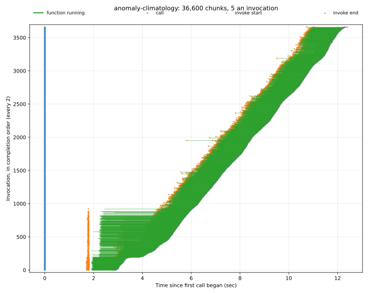
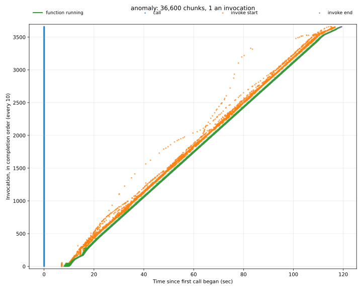

# Anomaly

[zarr-datafusion-lambda](../../README.md) › Benchmarks

`benchmarks/anomaly.py` computes each hour's departure of `t2m` from its
cell's mean at that hour of the day, over the same window: xarray-sql's
anomaly, case 4 of [its geospatial
cases](https://xql.systems/xarray-sql/latest/geospatial/#the-mapping). Like
the [climatology](climatology.md), it reads ERA5 in its time-series layout
(`single/temporal`), where a chunk is a "pencil": a year of hours (8,736) over
a 12 x 12 tile.

xarray-sql's query is a climatology CTE joined back with the observations:

```sql
WITH clim AS (
  SELECT latitude, longitude,
         date_part('hour', CAST(valid_time AS TIMESTAMP)) AS hour,
         avg(t2m) AS clim_t
  FROM era5
  WHERE valid_time >= TIMESTAMP '{start}' AND valid_time < TIMESTAMP '{end}'
  GROUP BY 1, 2, 3
)
SELECT a.valid_time, a.latitude, a.longitude, a.t2m - c.clim_t AS anomaly
FROM era5 a
JOIN clim c
  ON a.latitude = c.latitude AND a.longitude = c.longitude
 AND date_part('hour', CAST(a.valid_time AS TIMESTAMP)) = c.hour
WHERE a.valid_time >= TIMESTAMP '{start}' AND a.valid_time < TIMESTAMP '{end}'
```

The climatology of every cell is 25M rows, too many to send each worker, so
the benchmark runs it as two statements. The CTE is written to Zarr first,
a chunk a tile, as the climatology benchmark does:

```sql
COPY (
  SELECT latitude, longitude,
         date_part('hour', CAST(valid_time AS TIMESTAMP)) AS hour,
         avg(t2m) AS clim_t
  FROM era5
  WHERE valid_time >= TIMESTAMP '{start}' AND valid_time < TIMESTAMP '{end}'
  GROUP BY 1, 2, 3
) TO 's3://<bucket>/climatology.zarr' STORED AS ZARR OPTIONS ('chunks' '24,12,12')
```

Then the query runs as written, with `clim` a table over that store, and its
rows written to Zarr in float32, a chunk a pencil:

```sql
COPY (
  SELECT a.valid_time, a.latitude, a.longitude,
         CAST(a.t2m - c.clim_t AS REAL) AS anomaly
  FROM clim c
  JOIN era5 a
    ON a.latitude = c.latitude AND a.longitude = c.longitude
   AND date_part('hour', CAST(a.valid_time AS TIMESTAMP)) = c.hour
  WHERE a.valid_time >= TIMESTAMP '{start}' AND a.valid_time < TIMESTAMP '{end}'
) TO 's3://<bucket>/anomaly.zarr' STORED AS ZARR OPTIONS ('chunks' '8736,12,12')
```

Each invocation of the join reads one pencil, and the box of the climatology
over the pencil's cells, a 24 x 12 x 12 chunk, and writes the pencil's chunk
of the output, returning only a count. As the climatology is written
already, an invocation needs no more than its own pencil, so it holds a
pencil's rows, whatever the window. The join equates every coordinate the
two stores share, latitude and longitude, so an invocation's box of the
climatology is found from its coordinates.

## Running it

From a checkout, deployed [from source](../../README.md#from-source) with the
output's bucket allowed. By default it runs over a week, a rehearsal that
costs about $0.25:

```shell
uv run python benchmarks/anomaly.py s3://<bucket>/anomaly-week.zarr \
    --climatology s3://<bucket>/anomaly-week-climatology.zarr
```

A window over more than one band of pencils is widened to the bands it
reaches into, so that the output's chunks are the pencils. Five pencils,
from 2019-09-23 to 2024-09-16:

```shell
uv run python benchmarks/anomaly.py s3://<bucket>/anomaly-5y.zarr \
    --climatology s3://<bucket>/anomaly-5y-climatology.zarr \
    --start 2019-09-23 --end 2024-09-16 --dispatchers 2
```

One dispatcher's request holds the inputs of about 30,000 invocations of the
join, each naming its pencil and its box of the climatology, so five years
needs two dispatchers. `--climatology-written` runs only the join, over a
climatology written already for the same window.

The output is float32, about 5 MB a pencil before compression, 125 GiB for
the five years, which costs about $3 a month to keep in S3 Standard:

```shell
aws s3 rm --recursive s3://<bucket>/anomaly-5y.zarr/
aws s3 rm --recursive s3://<bucket>/anomaly-5y-climatology.zarr/
```

## Results

In one run, the five pencils from 2019-09-23 to 2024-09-16 took 152s and cost
approximately $1.26:

- the climatology, 20.3s and $0.25: 7,320 invocations, each a tile's five
  pencils, the workers using at most 234 MB of their 1769 MB;
- the join, 131.5s and $1.01: 36,600 invocations, each a pencil, through two
  dispatchers in about 37 waves at a concurrency of 990, the workers using at
  most 356 MB. It wrote 45,350,323,200 rows.

The costs leave out the workers' ~43,900 writes to the outputs, about $0.22.





The join's invocations spent 0.87s in their handlers at the median, but took
2.4s from the client's side, so its time is mostly its waves of invocations
rather than their work.

It hasn't been run over the whole record. Each of the join's invocations is
a pencil on its own, so nothing in it changes with the window: at the five
years' cost an invocation, the whole record's 87 bands of pencils would be
636,840 invocations in about 643 waves, about 35 minutes, and cost about
$21 with its climatology, and about $3 more for writing about 2.1 TiB.

## Checking the results

```shell
# a tile of the output against xarray, reading the tile's pencils from us-east-1
uv run benchmarks/anomaly_check.py results/anomaly-<a run>.json
```

The check computes the tile's climatology and anomaly with xarray, from the
same pencils over the same window, in float64 before casting to float32 as
the query does, and compares every cell. The five years' tile at 57.25°N to
60°N, 0°E to 2.75°E matches xarray exactly in all 6,289,920 cell-hours.
