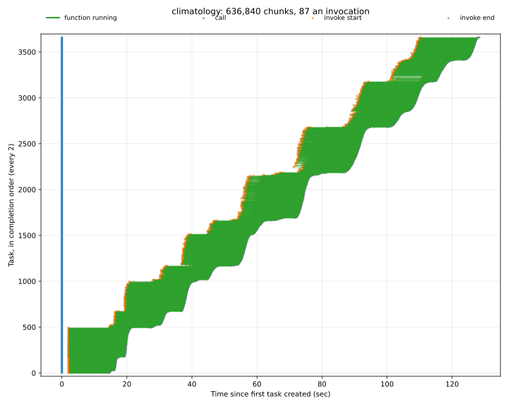

# Hourly climatology

[zarr-datafusion-lambda](../../README.md) › Benchmarks

`benchmarks/climatology.py` computes the mean `t2m` of every grid cell for
each hour of the day: xarray-sql's climatology, case 2 of [its geospatial
cases](https://xql.systems/xarray-sql/latest/geospatial/#the-mapping). It
reads ERA5 in its time-series layout (`single/temporal`), where a chunk is a
"pencil": a year of hours (8,736) over a 12 x 12 tile. The output is 24 x 721
x 1440 cells, written by the workers to a Zarr store with a chunk a tile:

```sql
COPY (
  SELECT latitude, longitude,
         date_part('hour', CAST(valid_time AS TIMESTAMP)) AS hour,
         avg(t2m) AS clim, count(*) AS n
  FROM era5
  WHERE valid_time >= TIMESTAMP '{start}' AND valid_time < TIMESTAMP '{end}'
  GROUP BY 1, 2, 3
) TO 's3://<bucket>/climatology.zarr' STORED AS ZARR OPTIONS ('chunks' '24,12,12')
```

Each of the 7,320 invocations takes one tile's whole stack of pencils, so its
rows are final: it finishes the aggregate, writes its tile's chunk, and
returns only a count.

## Running it

From a checkout, deployed [from source](../../README.md#from-source) with the
output's bucket allowed. By default it runs over a week, which is useful for
checking it works first (costs about $0.12).

```shell
uv run python benchmarks/climatology.py s3://<bucket>/climatology-week.zarr
```

Then the whole record:

```shell
uv run python benchmarks/climatology.py s3://<bucket>/climatology.zarr --start 1940-01-01 --end 2026-01-01
```

## Results

In one run, the whole record took 135.8s and cost approximately $3.07: 7,320
invocations of 87 pencils, in about 7.4 waves at a concurrency of 990. The
cost includes about $0.07 for the workers' ~14,640 writes to the output, which
the run's report leaves out.



## Checking the results

```shell
# one tile, 57.25 to 60°N and 0 to 2.75°E, against xarray reading the same pencils
uv run --with xarray --with "numcodecs[pcodec]" --with obstore python benchmarks/climatology_check.py \
  --output s3://<bucket>/climatology.zarr --start 1940-01-01 --end 2026-01-01
```

The tile matches xarray exactly. The check reads the tile's chunk alone, in
about 2 seconds.
