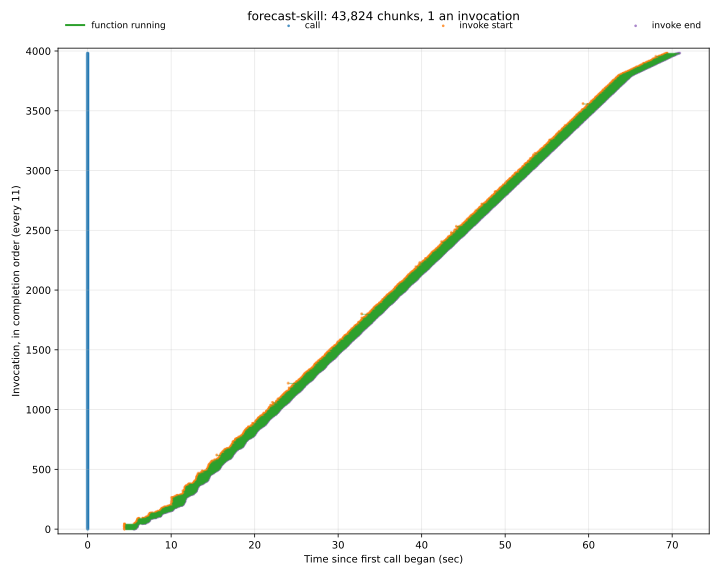

# Forecast skill

[zarr-datafusion-lambda](../../README.md) › Benchmarks

`benchmarks/forecast_skill.py` scores a forecast of `t2m` against ERA5 by its
RMSE at each lead: xarray-sql's forecast skill, case 5 of [its geospatial
cases](https://xql.systems/xarray-sql/latest/geospatial/#the-mapping).
xarray-sql scores WeatherBench 2's Pangu and GraphCast forecasts, which are in
Google Cloud Storage, so this scores a persistence forecast instead: ERA5 at
each hour of a window, as the forecast for 6, 24 and 72 hours later. It reads
the same ERA5 as the [global mean](global-mean.md), a chunk an hour.

xarray-sql's query joins the forecasts with ERA5 at their valid time:

```sql
SELECT f.model, f.prediction_timedelta AS lead,
       SQRT(AVG(POWER(CAST(f."2m_temperature" AS DOUBLE) - e."2m_temperature", 2))) AS rmse
FROM forecasts f
JOIN era5 e
  ON  e.time = f.time + f.prediction_timedelta  -- valid = init + lead
  AND e.latitude  = f.latitude
  AND e.longitude = f.longitude
GROUP BY f.model, f.prediction_timedelta
```

Here the forecasts are ERA5 crossed with a small table of leads:

```sql
SELECT f.lead_h,
       sqrt(avg(power(CAST(f.t2m AS DOUBLE) - e.t2m, 2))) AS rmse,
       count(*)                                           AS n
FROM era5 e
JOIN (
  SELECT l.lead_h, latitude, longitude, t2m, CAST(valid_time AS TIMESTAMP) + l.lead AS valid
  FROM (VALUES (6, INTERVAL '6 hours'), (24, INTERVAL '24 hours'),
               (72, INTERVAL '72 hours')) AS l(lead_h, lead)
  CROSS JOIN era5
  WHERE valid_time >= TIMESTAMP '{start}' AND valid_time < TIMESTAMP '{end}'
) f
  ON e.latitude = f.latitude
 AND e.longitude = f.longitude
 AND CAST(e.valid_time AS TIMESTAMP) = f.valid
GROUP BY f.lead_h
ORDER BY f.lead_h
```

The valid time is in a subquery, as Apache DataFusion drops an `ON` condition
on a column from an earlier `CROSS JOIN`. The truth and the leads are written
first, as DataFusion holds the table written first in memory: the leads are
sent to every worker in its fragment, and the truth is read by each worker for
its own chunks.

Each invocation reads an hour of the forecast and, for each lead, the hour of
ERA5 it reaches, found from the times of the two and the leads, and joins
them. It returns a partial row for each lead, which the dispatchers merge as
for the [zonal mean](zonal-mean.md).

## Running it

From a checkout, deployed [from source](../../README.md#from-source). By
default it runs over a week, which costs about $0.01:

```shell
uv run python benchmarks/forecast_skill.py
```

Then five years, which costs about $1.70:

```shell
uv run python benchmarks/forecast_skill.py --start 2019-01-01 --end 2024-01-01
```

One dispatcher's request holds the inputs of about 30,000 invocations, each
naming its hour and the hours its leads reach, so five years takes two
dispatchers, which the client adds itself.

## Results

In one run, the five years from 2019-01-01 to 2024-01-01 took 77.7s and cost
approximately $1.69: 43,824 invocations, each a forecast hour, through two
dispatchers in about 45 waves at a concurrency of 990, the workers using at
most 377 MB of their 1769 MB. Each lead's RMSE is over 45,499,829,760 cells:

| Lead | RMSE |
| --- | --- |
| 6h | 2.636 K |
| 24h | 2.554 K |
| 72h | 3.712 K |

The 6h forecast is worse than the 24h one: 6 hours on, it is another time of
day.



It hasn't been run over the whole record. At the five years' cost an
invocation, the whole record's ~745,000 hours would be ~745,000 invocations
in about 750 waves, about 19 minutes, and cost about $29.

## Checking the results

```shell
# every lead of a week's run against xarray, reading about 1 GB from us-east-1
uv run benchmarks/forecast_skill_check.py results/forecast-skill-<a week's run>.json
```

The check computes each lead's RMSE with xarray an hour at a time. A week's
run matches xarray to within a relative 1.2e-11 at every lead, the
difference from summing in another order. A longer run is checked by its
counts: each lead's is every cell of every hour of the window.
