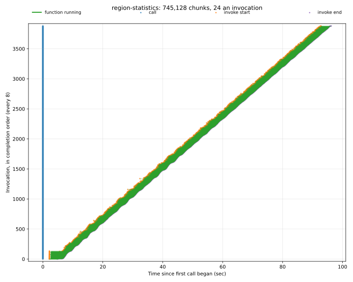

# Region statistics

[zarr-datafusion-lambda](../../README.md) › Benchmarks

`benchmarks/region_statistics.py` computes the mean `t2m` inside each of five
continental boxes, over the same ERA5 as the [global mean](global-mean.md):
xarray-sql's zonal statistics over regions, case 6 of [its geospatial
cases](https://xql.systems/xarray-sql/latest/geospatial/#the-mapping), with
boxes for regions.

```sql
SELECT r.region, avg(a.t2m) - 273.15 AS avg_c, count(*) AS n
FROM (VALUES ('Amazon', -10.0, 5.0, 290.0, 310.0),
             ('Australia_Outback', -30.0, -20.0, 125.0, 140.0),
             ('Greenland', 65.0, 80.0, 300.0, 340.0),
             ('SE_Asia', 5.0, 20.0, 95.0, 110.0),
             ('Sahara', 18.0, 30.0, 0.0, 30.0)) AS r(region, south, north, west, east)
JOIN era5 a
  ON a.latitude BETWEEN r.south AND r.north AND a.longitude BETWEEN r.west AND r.east
WHERE a.valid_time >= TIMESTAMP '{start}' AND a.valid_time < TIMESTAMP '{end}'
GROUP BY r.region
ORDER BY r.region
```

The boxes are a small table, so every worker is sent it in its fragment and
joins its own chunks with it. They are written first: DataFusion holds the
table written first in memory and streams the other past it, so written the
other way round, the raster would be held in memory and the query would not
fan out. Every invocation returns a partial row for every box, which the
dispatchers merge as for the [zonal mean](zonal-mean.md).

## Running it

From a checkout, deployed [from source](../../README.md#from-source). By
default it runs over a month:

```shell
uv run python benchmarks/region_statistics.py
```

Then the whole record, which costs about $2.50:

```shell
uv run python benchmarks/region_statistics.py --start 1940-01-01 --end 2025-01-01
```

## Results

In one run, the whole record took 101.6s and cost approximately $2.49: 31,047
invocations of 24 hourly chunks, merged into one state by one dispatcher.



## Checking the results

```shell
# every box of a month's run against xarray, reading about 3 GB from us-east-1
uv run benchmarks/region_statistics_check.py results/region-statistics-<a month's run>.json
```

A month's run matches xarray exactly in every box.
