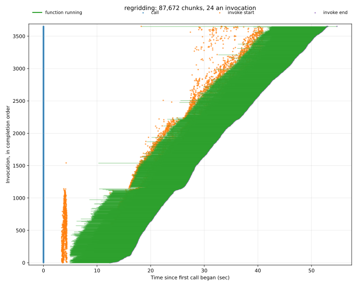

# Regridding

[zarr-datafusion-lambda](../../README.md) › Benchmarks

`benchmarks/regridding.py` regrids `t2m` from ERA5's 0.25° grid to 1°, every
hour: xarray-sql's regridding, case 8 of [its geospatial
cases](https://xql.systems/xarray-sql/latest/geospatial/#the-mapping). It is a
join with a table of first-order conservative weights, each 1° cell the
area-weighted mean of the 0.25° cells it overlaps, and a weighted sum by
target cell and hour, written by the workers to a Zarr store with a chunk a
day:

```sql
COPY (
  SELECT s.valid_time          AS valid_time,
         w.dst_lat             AS latitude,
         w.dst_lon             AS longitude,
         sum(s.t2m * w.weight) AS t2m
  FROM weights w
  JOIN era5 s ON s.latitude = w.src_lat AND s.longitude = w.src_lon
  WHERE s.valid_time >= TIMESTAMP '{start}' AND s.valid_time < TIMESTAMP '{end}'
  GROUP BY 1, 2, 3
) TO 's3://<bucket>/regridded.zarr' STORED AS ZARR OPTIONS ('chunks' '24,181,360')
```

The weights are Parquet in S3, written by `benchmarks/regrid_weights.py`:
1.6M rows, a 1 MB file, but 65 MB in memory. Every worker reads them whole and
joins its own chunks with them. A table read from files is joined this way when
its rows take at most `lambda.broadcast_bytes` in memory, 400 MB by default.
An hour's cells are all in one chunk, so each worker finishes the sum for its
hours, writes its day's chunk, and returns only a count.

The output's grid comes from the weights: its latitude runs from -90 to 90, as
the writer orders an axis taken from a table, and as xarray-sql's own
regridding does, rather than from 90 to -90 as ERA5's does.

## Running it

From a checkout, deployed [from source](../../README.md#from-source) with the
bucket allowed, which the workers read the weights from and write the output
to. First the weights:

```shell
uv run python benchmarks/regrid_weights.py s3://<bucket>/era5-1deg-weights.parquet
```

By default it runs over a month, 31 invocations:

```shell
uv run python benchmarks/regridding.py s3://<bucket>/regridded-2020-01.zarr \
    --weights s3://<bucket>/era5-1deg-weights.parquet
```

Then ten years:

```shell
uv run python benchmarks/regridding.py s3://<bucket>/regridded-2015-2024.zarr \
    --weights s3://<bucket>/era5-1deg-weights.parquet \
    --start 2015-01-01 --end 2025-01-01
```

The output is float64, about 12.5 MB a day, so ten years is about 46 GB, and
it costs about $1 a month to keep in S3 Standard:

```shell
aws s3 rm --recursive s3://<bucket>/regridded-2015-2024.zarr/
```

## Results

In one run, the ten years from 2015 to 2024 took 66.1s and cost approximately
$0.87: 3,653 invocations of 24 hourly chunks, in about 3.7 waves at a
concurrency of 990, the workers using at most 859 MB of their 1769 MB. The
cost leaves out the workers' ~3,700 writes to the output, about $0.02.



It hasn't been run over the whole record. Each invocation is a day on its own,
so nothing in it changes with the window: at the ten years' cost an
invocation, the whole record's 31,047 days would take about 32 waves, about 6 to
7 minutes, and cost about $7.50, writing about 380 GB.

## Checking the results

```shell
# the run's first 31 days at most against xarray, reading about 3 GB from us-east-1
uv run benchmarks/regridding_check.py results/regridding-<a run>.json
```

The check regrids the same hours with the same weights as matrices, and
compares every cell. The ten years' first month matches xarray to within
3e-13 K in all 48,479,040 cells.
