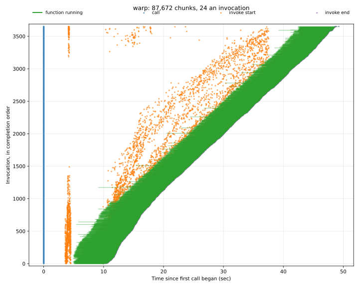

# Warp

[zarr-datafusion-lambda](../../README.md) › Benchmarks

`benchmarks/warp.py` warps `t2m` from ERA5's 0.25° latitude-longitude grid
onto Europe's Lambert azimuthal equal-area grid (EPSG:3035) at 25 km, every
hour: xarray-sql's warp, case 9 of [its geospatial
cases](https://xql.systems/xarray-sql/latest/geospatial/#the-mapping). As
there, a warp is a reprojection of the target grid followed by a regridding:
each target cell's centre is projected into the source's coordinates, given
bilinear weights from the four source cells around where it falls, and the
weights are applied by a join and a weighted sum by target cell and hour,
written by the workers to a Zarr store with a chunk a day:

```sql
COPY (
  SELECT s.valid_time          AS valid_time,
         w.dst_y               AS y,
         w.dst_x               AS x,
         sum(s.t2m * w.weight) AS t2m
  FROM weights w
  JOIN era5 s ON s.latitude = w.src_lat AND s.longitude = w.src_lon
  WHERE s.valid_time >= TIMESTAMP '{start}' AND s.valid_time < TIMESTAMP '{end}'
  GROUP BY 1, 2, 3
) TO 's3://<bucket>/warped.zarr' STORED AS ZARR OPTIONS ('chunks' '24,272,319')
```

xarray-sql warps the other way, from a UTM grid onto latitude and longitude,
as its source, SRTM elevation, is projected. ERA5 is already on latitude and
longitude, so here the target is the projected grid.

The target grid is the projected box around EPSG:3035's area of use, which
runs from the Azores to Türkiye and up to Svalbard, so the box takes in North
Africa and the Middle East too: 272 by 319 cells, 87k in all, with `y` and `x`
in metres. Projecting it is the same for every hour, so it is done once, with
pyproj, by `benchmarks/warp_weights.py`, which writes the weights as Parquet in
S3: 347k rows, a 3.4 MB file, about 14 MB in memory. Every worker reads them
whole and joins its own chunks with them, as in
[regridding](regridding.md). The grid crosses 0°E, where a target cell
between ERA5's last column, 359.75°E, and its first takes its weights from
both.

The output's Zarr store has `y` and `x` coordinates, but nothing in it says
they are EPSG:3035, which the writer has no way to record.

## Running it

From a checkout, deployed [from source](../../README.md#from-source) with the
bucket allowed, which the workers read the weights from and write the output
to. First the weights, with pyproj, which the script declares itself:

```shell
uv run benchmarks/warp_weights.py s3://<bucket>/era5-laea-weights.parquet
```

By default it runs over a month, 31 invocations:

```shell
uv run python benchmarks/warp.py s3://<bucket>/warped-2020-01.zarr \
    --weights s3://<bucket>/era5-laea-weights.parquet
```

Then ten years:

```shell
uv run python benchmarks/warp.py s3://<bucket>/warped-2015-2024.zarr \
    --weights s3://<bucket>/era5-laea-weights.parquet \
    --start 2015-01-01 --end 2025-01-01
```

The output is float64, about 16.7 MB a day, so ten years is about 61 GB, and
it costs about $1.40 a month to keep in S3 Standard:

```shell
aws s3 rm --recursive s3://<bucket>/warped-2015-2024.zarr/
```

## Results

In one run, the ten years from 2015 to 2024 took 58.8s and cost approximately
$0.52: 3,653 invocations of 24 hourly chunks, in about 3.7 waves at a
concurrency of 990, the workers using at most 881 MB of their 1769 MB. The
cost leaves out the workers' ~3,700 writes to the output, about $0.02.



It hasn't been run over the whole record. Each invocation is a day on its own,
so nothing in it changes with the window: at the ten years' cost an
invocation, the whole record's 31,047 days would take about 32 waves, about 8
minutes, and cost about $4.40, writing about 520 GB.

## Checking the results

```shell
# the run's first 31 days at most against xarray, reading about 3 GB from us-east-1
uv run benchmarks/warp_check.py results/warp-<a run>.json
```

The check doesn't use the weights: it interpolates the same hours with
xarray's `interp` at the target cells' centres, projected with pyproj, as
xarray-sql checks its warp, and compares every cell. The ten years' first
month matches xarray to within 3e-13 K in all 64,555,392 cells.
