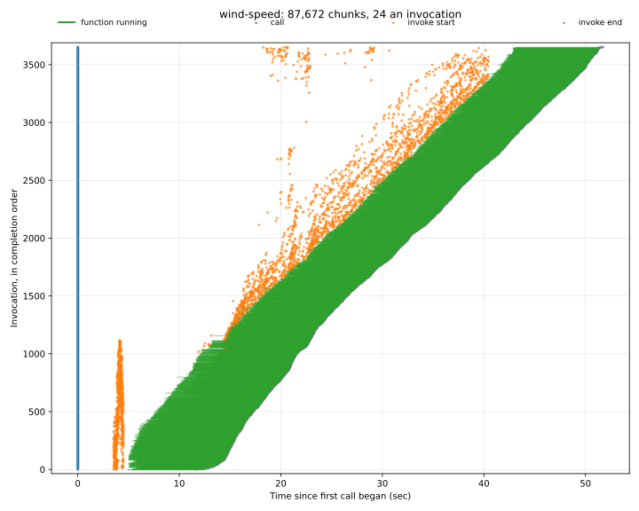

# Wind speed

[zarr-datafusion-lambda](../../README.md) › Benchmarks

`benchmarks/wind_speed.py` computes the 10 m wind speed from its two
components, `u10` and `v10`, for every cell and hour on ERA5's 0.25° grid. It
has the shape of xarray-sql's spectral index (NDVI), case 1 of [its geospatial
cases](https://xql.systems/xarray-sql/latest/geospatial/#the-mapping):
arithmetic on two variables in each cell, with no aggregate. It is written by
the workers to a Zarr store with a chunk a day:

```sql
COPY (
  SELECT valid_time, latitude, longitude, sqrt(u10 * u10 + v10 * v10) AS wind_speed
  FROM era5
  WHERE valid_time >= TIMESTAMP '{start}' AND valid_time < TIMESTAMP '{end}'
) TO 's3://<bucket>/wind-speed.zarr' STORED AS ZARR OPTIONS ('chunks' '24,721,1440')
```

The two variables share their group's chunking, so they read as one table.
With no aggregate, every row read is a row of the output, too many to send
back, so a query like this runs on the workers only when it is written to
Zarr. Each worker reads a day's chunks of both variables, writes that day's
output chunk, and returns only a count. The output's coordinates keep the
source's names, which is how the writer matches them to the source's axes.

## Running it

From a checkout, deployed [from source](../../README.md#from-source) with the
bucket allowed, which the workers write the output to. By default it runs over
a month, 31 invocations:

```shell
uv run python benchmarks/wind_speed.py s3://<bucket>/wind-speed-2020-01.zarr
```

Then ten years:

```shell
uv run python benchmarks/wind_speed.py s3://<bucket>/wind-speed-2015-2024.zarr \
    --start 2015-01-01 --end 2025-01-01
```

The output is float32, about 100 MB a day before compression and 75 MB after,
so ten years is 263 GiB, and it costs about $6 a month to keep in S3 Standard:

```shell
aws s3 rm --recursive s3://<bucket>/wind-speed-2015-2024.zarr/
```

## Results

In one run, the ten years from 2015 to 2024 took 58.4s and cost approximately
$0.78: 3,653 invocations, each reading 24 hourly chunks of both variables, in
about 3.7 waves at a concurrency of 990, the workers using at most 709 MB of
their 1769 MB. Together they read 0.73 TB, uncompressed, and wrote
91,024,577,280 rows. The cost leaves out the workers' ~3,700 writes to the
output, about $0.02.



It hasn't been run over the whole record. Each invocation is a day on its own,
so nothing in it changes with the window: at the ten years' cost an
invocation, the whole record's 31,047 days would take about 32 waves, about 5
to 8 minutes, and cost about $6.60, writing about 2.3 TB.

## Checking the results

```shell
# the run's first 31 days at most against xarray, reading about 6 GB from us-east-1
uv run benchmarks/wind_speed_check.py results/wind-speed-<a run>.json
```

The check computes the same hours' wind speed with xarray, in float32 as the
query does, and compares every cell. The ten years' first five days match
xarray exactly, in all 124,588,800 cells.
