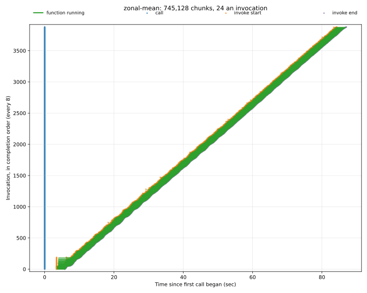

# Zonal mean

[zarr-datafusion-lambda](../../README.md) › Benchmarks

`benchmarks/zonal_mean.py` computes the mean `t2m` of each of the 721
latitudes, over the same ERA5 as the [global mean](global-mean.md): xarray-sql's
zonal mean, case 3 of [its geospatial
cases](https://xql.systems/xarray-sql/latest/geospatial/#the-mapping).

```sql
SELECT latitude, avg(t2m) - 273.15 AS air_mean_c, count(*) AS n
FROM era5
WHERE valid_time >= TIMESTAMP '{start}' AND valid_time < TIMESTAMP '{end}'
GROUP BY latitude
ORDER BY latitude DESC
```

Every invocation returns a partial row for every latitude, 35 KB, so the
partial rows grow with the invocations rather than with the answer. The
dispatchers merge them as they arrive, through the
`dispatcher-partial-reduce` function, and send the client one state each.

## Running it

From a checkout, deployed [from source](../../README.md#from-source). By
default it runs over a month:

```shell
uv run python benchmarks/zonal_mean.py
```

Then the whole record, which costs about $2.25:

```shell
uv run python benchmarks/zonal_mean.py --start 1940-01-01 --end 2025-01-01
```

## Results

In one run, the whole record took 92.2s and cost approximately $2.25: 31,047
invocations of 24 hourly chunks, merged into one state by one dispatcher.



## Checking the results

```shell
# every latitude of a month's run against xarray, reading about 3 GB from us-east-1
uv run benchmarks/zonal_mean_check.py results/zonal-mean-<a month's run>.json
```

A month's run matches xarray to within 1e-6°C at every latitude.
